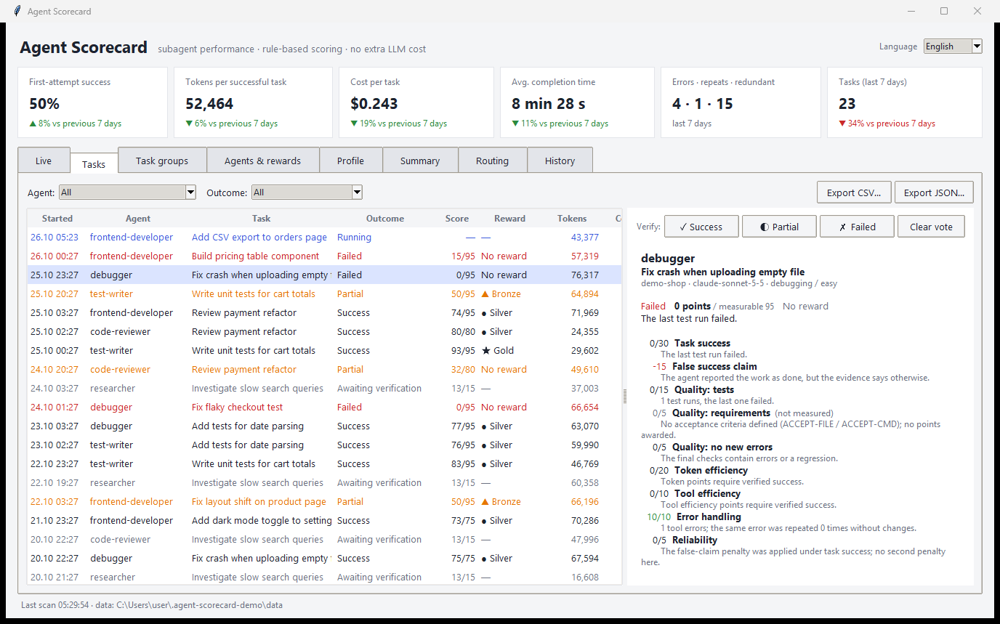
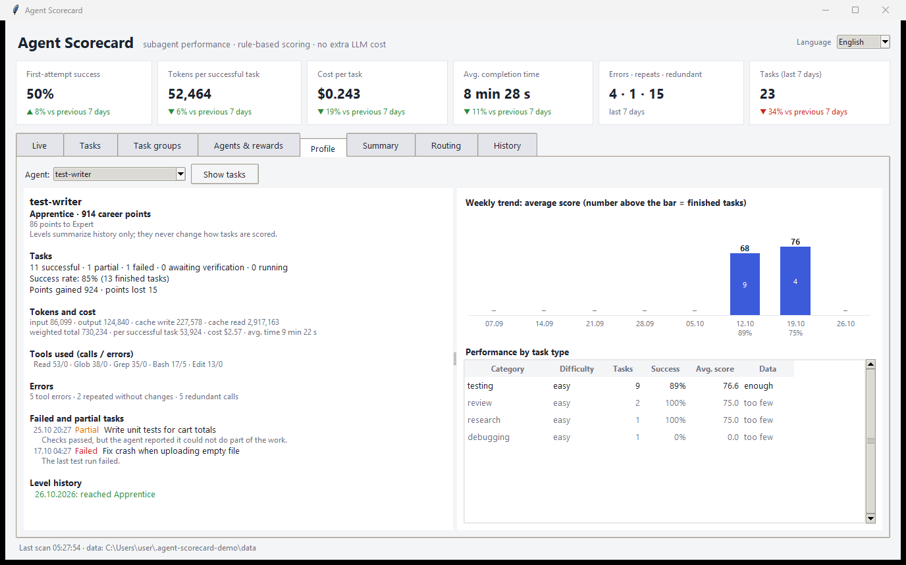
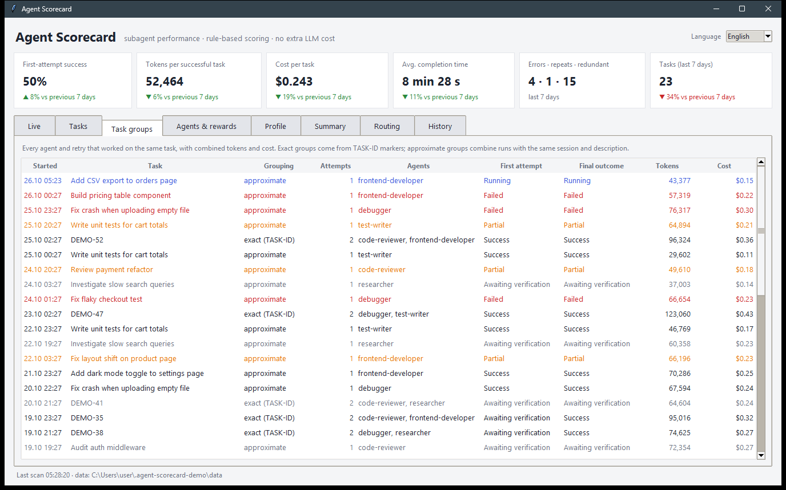
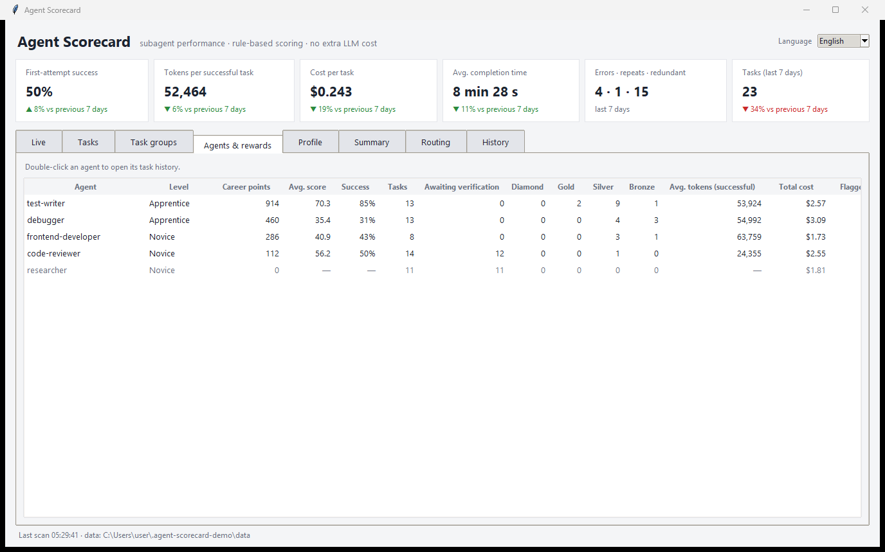
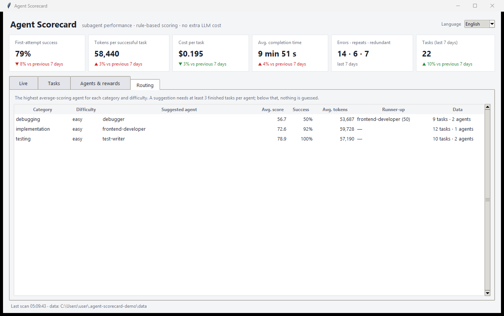

# Agent Scorecard

**English** · [Türkçe](README.tr.md)

A Claude Code plugin that tracks what your subagents do, scores every task out of 100 with fixed,
inspectable rules, and rewards agents that deliver **verified** results without wasting tokens.
It comes with a desktop dashboard with an English/Turkish language switch.

**Scoring never calls an LLM.** Everything is computed from the subagent transcripts Claude Code already
writes to disk, using plain Python and a local SQLite file. Python 3.10+ is the only requirement.



## What it does

- **Tracks every subagent:** which agent ran which task, input/output/cache tokens, tool calls, errors, duration, and API-equivalent cost.
- **Checks results against evidence:** test runs, build/lint checks and acceptance criteria. A task that cannot be verified is marked *awaiting verification*, not success.
- **Scores each task out of 100** in six sections. Every point can be traced back to the data it came from.
- **Rewards good work:** Diamond / Gold / Silver / Bronze tiers per task, plus career points and levels (Novice → Apprentice → Expert → Master → Elite → Legend) per agent.
- **Keeps an honest history:** every score, correction and vote goes into an append-only, hash-chained log. Failed tasks cannot be deleted to inflate a success rate, and tampering is detected.
- **Profiles every agent:** success rate, points gained and lost, tokens and cost, tools used, failures, strongest task types and the weekly trend.
- **Counts the full cost of a task:** when several agents or retries work on the same task, their cost is added up.
- **Spots waste:** identical calls that returned identical output with nothing changed in between, and the same error retried without changes.
- **Suggests routing:** which agent has the best track record for each task category and difficulty. Suggestions are only shown when there is enough data.

## Install

In Claude Code:

```
/plugin marketplace add BishaThemis/agent-scorecard
/plugin install agent-scorecard@agent-scorecard
```

Restart Claude Code afterwards. The hooks call `python`, so make sure `python --version` works in your terminal.

| Command | What it does |
|---|---|
| `/scorecard` | Prints the scorecard as text in the conversation |
| `/scorecard dashboard` | Opens the desktop dashboard |
| `/scorecard --lang tr` | Prints the scorecard in Turkish |
| `/scorecard export --format csv --out tasks.csv` | Exports tasks as CSV (`--format json` also includes task groups, career points and the full event log) |

You can also double-click `plugins/agent-scorecard/scripts/dashboard.pyw`. On first start, the dashboard scans
all existing transcripts, so subagents that ran before you installed the plugin show up too.

## How it works

```
Claude Code ──writes──▶ ~/.claude/projects/*/<session>/subagents/agent-*.jsonl  (+ .meta.json)
     │                                    │
     │ SubagentStart / SubagentStop       │ read-only
     ▼                                    ▼
 hooks/hook.py ──────────────▶ transcript.py  →  measurements (tokens, calls, tests, claims)
                                          │
                                          ▼
                               scoring.py  →  outcome, score, tier, breakdown
                                          │
                                          ▼
                          ~/.agent-scorecard/scorecard.db  ◀── dashboard.pyw, /scorecard
```

1. **SubagentStart** adds a placeholder so the agent appears in the *Live* tab right away.
2. While an agent runs, the dashboard re-reads its transcript every few seconds to show live token and tool counts.
3. **SubagentStop** parses the finished transcript, stores the measurements and rescores. The hook never blocks Claude: it always exits with 0 and writes any errors to `~/.agent-scorecard/hook.log`.
4. Tasks are scored in time order. A task's token reference only uses tasks that finished **before** it started, so new tasks never change older scores.
5. Every final score is credited once to the event log, and every later change is logged as its own positive or negative delta, with its reason: user vote, rules changed, comparison data changed, or new data. Career points are the sum of those deltas, kept apart from the per-task scores.

Details worth knowing:

- **Tokens are real API usage**, not estimates. One API message is split over several transcript lines, so usage is deduplicated by message ID.
- **The final report** comes from the `SubagentHandback` tool in current Claude Code versions, with a fallback to the last text message for older versions.
- **Category and difficulty** come only from the task description and prompt, never from how many tokens the agent spent. Otherwise an inefficient agent could make its own task look "hard" and be compared against a looser reference.

## Scoring rules

| Section | Points | How it is measured |
|---|---:|---|
| Task success | 30 | Last test/build results, acceptance criteria, or your vote in the dashboard. No evidence → *awaiting verification*, 0 points. Partial success is capped at 15. Reporting unfinished work as done: −15. |
| Output quality | 25 | Last test run passed: 15 · acceptance criteria met: 5 · no regression: 5. Anything that cannot be measured is not awarded. |
| Token efficiency | 20 | Compared with the mean of earlier **successful** tasks of the same category and difficulty: ≤0.5× → 20, 0.6× → 16, 0.8× → 10, 1.0× → 5, 1.2× → 2, ≥1.5× → 0, linear in between. Needs verified success and at least 3 reference tasks. |
| Tool efficiency | 10 | −1 per call that repeated the same input, got the same output, and had nothing change in between. Re-running tests and builds is never penalized. Needs verified success. |
| Error handling | 10 | −2 each time the same failing call is retried without changing anything. |
| Reliability | 5 | Evidence-backed report: 5 · clearly saying "not verified": 3 · claiming done or tests passing with no evidence: −15. A false claim already penalized under task success is not penalized again here. |

**Tiers:** 95+ Diamond · 85+ Gold · 70+ Silver · 50+ Bronze.

Every score is shown with its **measurable maximum**. For example, *75/95* means tests and checks existed, but
the token comparison is not possible yet. Missing data is never shown as failure or as success.

Built-in protections against gaming the score:

- Efficiency points require verified success, so doing less work to save tokens never pays off.
- Failed tasks stay in the history and count against the success rate.
- The same event is never penalized in two sections.

### Career points and levels

Career points add up each agent's final task scores over time. Levels are based on career points:
Novice (0) → Apprentice (300) → Expert (1,000) → Master (2,500) → Elite (5,000) → Legend (10,000).
The thresholds are configurable in `rules.json`.

Levels **summarize history only**. Nothing in the scoring engine reads them, so a high-level agent gets
exactly the same score as a new one for the same work. A test enforces this.

### History you can trust

- Votes, vote changes and score changes are appended to an event log. Each entry stores the hash of the previous one.
- Database triggers block editing or deleting events and deleting tasks, so even a manual SQL statement fails.
- The newest chain link is also saved in `chain_head.json` outside the database. Cutting entries from the end, or swapping in an older copy of the database, is detected.
- Every score stores a fingerprint of the rules it was computed with and the IDs of the reference tasks it was compared against.
- The *History* tab shows whether the chain is intact.

This makes tampering **visible, not impossible**. Someone who deletes both the database and the chain head
file starts a new, empty history.

### Prompt markers

The orchestrating agent can put these lines in a subagent's prompt to make verification and comparison exact.
Turkish aliases (`KABUL-DOSYA`, `KABUL-KOMUT`, `ZORLUK`, `KATEGORI`, `GOREV-ID`) also work.

```
ACCEPT-FILE: src/billing/invoice.py   # the file exists and this agent wrote or changed it
ACCEPT-CMD: npm test                  # the agent ran this command and the last run passed
DIFFICULTY: hard                      # easy | medium | hard
CATEGORY: debugging                   # testing, debugging, review, research, docs, refactor, planning, implementation
TASK-ID: BILL-142                     # groups several agents or retries working on the same task
```

## Configuration

Every threshold, weight, detection pattern and model price is in
[`rules.json`](plugins/agent-scorecard/scripts/scorecard/rules.json). To change rules, create
`~/.agent-scorecard/rules.json` with only the keys you want to override, then run
`python scripts/scorecard_cli.py rescore`.

Model prices are configurable for the same reason: they change. Models without a configured price show
"no price configured" instead of a guessed cost. The dashboard language is saved in
`~/.agent-scorecard/settings.json`.

## Dashboard

| Tab | Shows |
|---|---|
| Live | Subagents running right now, with elapsed time, tokens and tool calls |
| Tasks | Every task with outcome, score, tier, tokens and cost. Filter by agent and outcome. Select a task to see the full breakdown and verify it yourself (Success / Partial / Failed). CSV and JSON export |
| Task groups | Every agent and retry that worked on the same task, with combined tokens and cost. Groups are exact with `TASK-ID` and marked approximate otherwise |
| Agents & rewards | Level, career points, average score, success rate, tier counts, tokens and cost per agent. Double-click an agent to open its profile |
| Profile | One agent in depth: level progress, outcomes, points gained and lost, tokens and cost, tools, errors, failed tasks, level history, performance by task type, and an 8-week trend chart |
| Summary | Daily (14 days) and weekly (8 weeks) success rate, first-attempt success, tokens per success, cost per task, time, test pass rate and waste |
| Routing | The best-performing agent per category and difficulty, with the runner-up |
| History | The event log and whether its hash chain is intact |

The cards at the top compare the last 7 days with the 7 days before: first-attempt success, tokens per
successful task, cost per task (all agents and retries of a task combined), average completion time, and
errors / repeats / redundant calls.






To try the dashboard with fictional data:

```
python tools/make_demo.py %TEMP%\scorecard-demo
set CLAUDE_CONFIG_DIR=%TEMP%\scorecard-demo\claude
set AGENT_SCORECARD_DATA=%TEMP%\scorecard-demo\data
python plugins\agent-scorecard\scripts\dashboard.pyw
```

## Known limits

- **Cost is an API-equivalent figure** based on list prices. For subscription plans it is not your actual bill.
- **Task grouping without `TASK-ID` is approximate.** It assumes the same session and description mean the same task.
- **Orchestrator overhead is not counted.** Tokens the main agent spends writing a subagent's prompt and reading its result are not attributed to the subagent.
- **Claim detection is pattern-based.** "Partial" and "done" claims are found with text patterns in English and Turkish, so they can be wrong. Your vote in the dashboard always overrides automatic decisions.
- **Old transcripts get deleted.** Claude Code removes them after `cleanupPeriodDays`. The measurements stay in the database, but a deleted transcript cannot be re-parsed.
- **The transcript format is not a public API** and may change between Claude Code versions. The parser was written against Claude Code 2.1.310.
- **Developed and tested on Windows.** The scoring engine and hooks are plain Python and should work anywhere. The dashboard uses tkinter, which ships with most Python installs.

See [ROADMAP.md](ROADMAP.md) for what is planned next and what the current data can and cannot support.

## Development

```
cd plugins/agent-scorecard
python -m unittest discover -s tests
```
