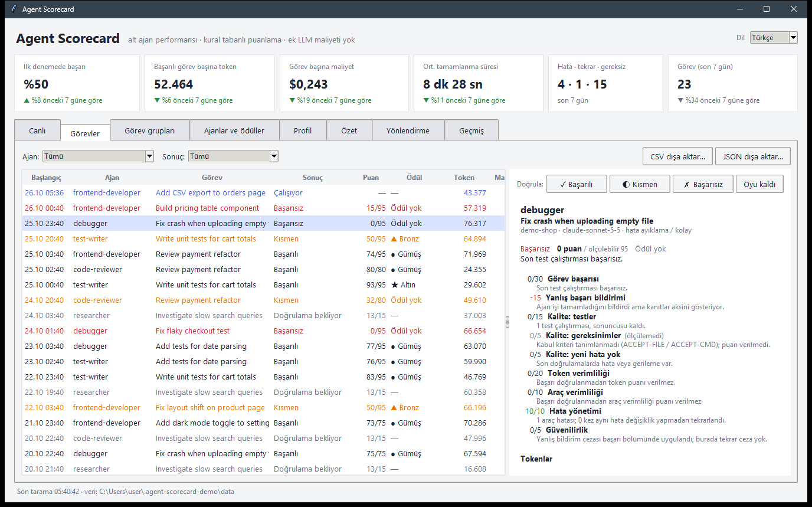
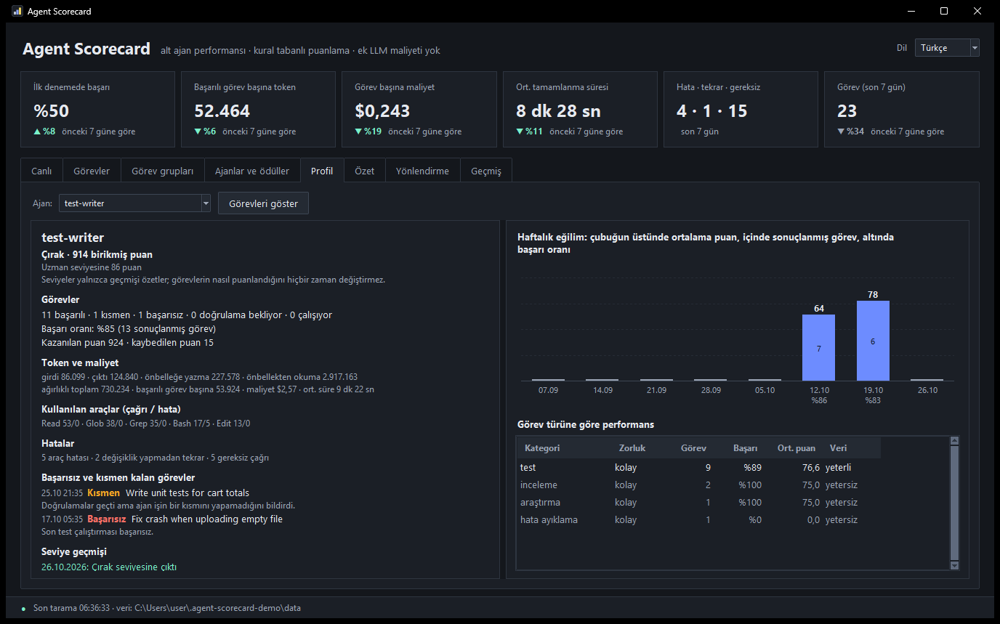

# Agent Scorecard

[English](README.md) · **Türkçe**

Claude Code alt ajanlarının ne yaptığını izleyen, her görevi sabit ve incelenebilir kurallarla 100 üzerinden
puanlayan ve **doğrulanmış** sonucu gereksiz token harcamadan üreten ajanları ödüllendiren bir Claude Code
eklentisi. İngilizce/Türkçe dil seçimli bir masaüstü paneliyle gelir.

**Puanlama hiçbir zaman LLM çağırmaz.** Her şey Claude Code'un zaten diske yazdığı alt ajan transkriptlerinden,
sıradan Python kodu ve yerel bir SQLite dosyasıyla hesaplanır. Tek gereksinim Python 3.10+.



## Ne yapar

- **Her alt ajanı izler:** hangi ajan hangi görevde çalıştı; girdi, çıktı ve önbellek tokenları, araç çağrıları, hatalar, süre ve API eşdeğeri maliyet.
- **Sonucu kanıtla karşılaştırır:** test çalıştırmaları, build/lint kontrolleri ve kabul kriterleri. Doğrulanamayan görev başarılı sayılmaz, *doğrulama bekliyor* olarak işaretlenir.
- **Her görevi altı bölümde 100 üzerinden puanlar.** Her puanın hangi veriden geldiği izlenebilir.
- **İyi işi ödüllendirir:** görev başına Elmas / Altın / Gümüş / Bronz kademeleri; ajan başına birikmiş puan ve seviye (Başlangıç → Çırak → Uzman → Usta → Elit → Efsane).
- **Dürüst bir geçmiş tutar:** her puan, düzeltme ve oy yalnızca eklenebilen, hash zincirli bir günlüğe yazılır. Başarı oranını yükseltmek için başarısız görevler silinemez; kurcalama fark edilir.
- **Her ajanın profilini çıkarır:** başarı oranı, kazanılan ve kaybedilen puan, token ve maliyet, kullanılan araçlar, başarısızlıklar, en güçlü görev türleri ve haftalık eğilim.
- **Görevin tam maliyetini hesaplar:** aynı göreve birden fazla ajan veya deneme harcandıysa maliyetleri toplanır.
- **İsrafı yakalar:** aynı girdiyle aynı çıktıyı veren ve arada hiçbir şeyin değişmediği tekrar çağrılar, değişiklik yapmadan tekrar denenen hatalar.
- **Yönlendirme önerir:** her görev kategorisi ve zorluğunda en iyi geçmişe sahip ajan. Öneri yalnızca yeterli veri varsa gösterilir.

## Kurulum

Claude Code kurulu herhangi bir terminalden (cmd, PowerShell, bash) tek komutla:

```
claude plugin install agent-scorecard --marketplace BishaThemis/agent-scorecard
```

Ya da Claude Code içinden:

```
/plugin marketplace add BishaThemis/agent-scorecard
/plugin install agent-scorecard@agent-scorecard
```

Güncellemek için: `claude plugin marketplace update agent-scorecard`. Kurduktan veya güncelledikten sonra Claude Code'u yeniden başlatın. Hook'lar `python` komutunu çağırır; `python --version` komutunun
terminalde çalıştığından emin olun.

| Komut | Ne yapar |
|---|---|
| `/scorecard` | Karneyi sohbette metin olarak gösterir |
| `/scorecard dashboard` | Masaüstü panelini açar |
| `/scorecard shortcut` | Windows masaüstüne **Agent Scorecard** kısayolu koyar (bir kez yeterli; eklenti güncellense de çalışır) |
| `/scorecard --lang tr` | Karneyi Türkçe gösterir |
| `/scorecard export --format csv --out gorevler.csv` | Görevleri CSV olarak dışa aktarır (`--format json` görev gruplarını, birikmiş puanları ve tüm olay günlüğünü de içerir) |

Eklentiyi kurmak masaüstüne bir şey koymaz; simge istiyorsanız bir kez `/scorecard shortcut` çalıştırın.
Panel koyu temalıdır: tüm metinler WCAG AA kontrastını sağlar ve Windows 10/11'de başlık çubuğu da koyudur.

Panelin sağ üst köşesindeki **Dil** seçiminden arayüzü Türkçe ya da İngilizce yapabilirsiniz. Seçim kaydedilir
ve geçmiş görevlerin puan dökümleri de seçilen dilde gösterilir.

## Nasıl çalışır

1. **SubagentStart** hook'u ajanı hemen *Canlı* sekmesine ekler.
2. Ajan çalışırken panel transkriptini birkaç saniyede bir okuyup token ve araç sayılarını canlı gösterir.
3. **SubagentStop** hook'u biten transkripti ayrıştırır, ölçümleri kaydeder ve yeniden puanlar. Hook Claude'u hiçbir zaman engellemez; hataları `~/.agent-scorecard/hook.log` dosyasına yazar.
4. Görevler zaman sırasıyla puanlanır. Token referansı yalnızca o görev **başlamadan önce** bitmiş görevlerden alınır, bu yüzden yeni görevler eski puanları değiştirmez.
5. Her kesinleşmiş puan olay günlüğüne bir kez yazılır; sonraki her değişiklik nedeniyle birlikte ayrı bir artı veya eksi kayıt olarak eklenir. Olası nedenler: kullanıcı oyu, kurallar değişti, karşılaştırma verisi değişti, yeni veri. Birikmiş puan bu kayıtların toplamıdır ve görev puanlarından ayrı tutulur.

### Birikmiş puan ve seviyeler

Seviyeler birikmiş puana göre belirlenir: Başlangıç (0) → Çırak (300) → Uzman (1.000) → Usta (2.500) →
Elit (5.000) → Efsane (10.000). Eşikler `rules.json` içinden değiştirilebilir. Seviyeler **yalnızca geçmişi
özetler**: puanlama motoru seviyeyi hiç okumaz, yüksek seviyeli bir ajan aynı iş için yeni bir ajanla birebir
aynı puanı alır. Bunu bir test denetler.

### Güvenilir geçmiş

- Oylar, oy değişiklikleri ve puan değişiklikleri bir olay günlüğüne eklenir; her kayıt bir öncekinin hash'ini taşır.
- Veritabanı tetikleyicileri olayların değiştirilmesini, silinmesini ve görevlerin silinmesini engeller.
- Zincirin son halkası veritabanı dışında `chain_head.json` dosyasında da tutulur. Böylece sondan kayıt silinmesi ya da veritabanının eski bir kopyayla değiştirilmesi fark edilir.
- Her puan, hesaplandığı kuralların parmak izini ve karşılaştırıldığı referans görevlerin kimliklerini saklar.
- *Geçmiş* sekmesi zincirin sağlam olup olmadığını gösterir.

Bu, kurcalamayı **imkânsız değil, görünür** kılar: hem veritabanını hem zincir başı dosyasını silen biri
yeni, boş bir geçmişle başlar.

Kategori ve zorluk yalnızca görev açıklamasından ve isteminden çıkarılır, ajanın harcadığı tokenlardan değil.

## Puanlama kuralları

| Bölüm | Puan | Ölçüm |
|---|---:|---|
| Görev başarısı | 30 | Son test/build sonuçları, kabul kriterleri veya paneldeki oyunuz. Kanıt yoksa *doğrulama bekliyor*, 0 puan. Kısmen başarı en fazla 15. Bitmemiş işi bitti diye bildirmek: −15. |
| Çıktı kalitesi | 25 | Son test geçti: 15 · kabul kriterleri: 5 · gerileme yok: 5. Ölçülemeyen kısım verilmez. |
| Token verimliliği | 20 | Aynı kategori ve zorluktaki daha önce **başarılı** olmuş görevlerin ortalamasına göre: ≤0,5× → 20, 0,6× → 16, 0,8× → 10, 1,0× → 5, 1,2× → 2, ≥1,5× → 0, arası orantılı. Doğrulanmış başarı ve en az 3 referans görev gerekir. |
| Araç verimliliği | 10 | Aynı girdiyle aynı çıktıyı veren ve arada hiçbir şeyin değişmediği her çağrı için −1. Test ve build tekrarları cezalandırılmaz. Doğrulanmış başarı gerekir. |
| Hata yönetimi | 10 | Başarısız bir çağrıyı hiçbir şey değiştirmeden tekrar denemek, her seferinde −2. |
| Güvenilirlik | 5 | Kanıtlı rapor: 5 · "doğrulamadım" diye açıkça belirtmek: 3 · kanıt olmadan "bitti/testler geçti" iddiası: −15. Yanlış bildirim başarı bölümünde cezalandırıldıysa burada tekrar cezalandırılmaz. |

**Kademeler:** 95+ Elmas · 85+ Altın · 70+ Gümüş · 50+ Bronz. Her puan **ölçülebilir maksimumuyla** birlikte
gösterilir; örneğin *75/95*, token karşılaştırmasının henüz yapılamadığı bir görevi anlatır.

### İstem işaretleri

Ana ajan, alt ajan istemine bu satırları ekleyerek doğrulamayı ve karşılaştırmayı kesinleştirebilir.
İngilizce adlar da (`ACCEPT-FILE`, `ACCEPT-CMD`, `DIFFICULTY`, `CATEGORY`, `TASK-ID`) çalışır.

```
KABUL-DOSYA: src/odeme/fatura.py    # dosya var ve bu ajan yazdı/değiştirdi
KABUL-KOMUT: npm test               # ajan bu komutu çalıştırdı ve son çalıştırma geçti
ZORLUK: zor                         # kolay | orta | zor
KATEGORI: hata ayıklama
GOREV-ID: FAT-142                   # aynı işe birden fazla ajan veya deneme varsa gruplar
```

## Panel

| Sekme | Gösterdiği |
|---|---|
| Canlı | Şu an çalışan alt ajanlar |
| Görevler | Tüm görevler, puan dökümü, elle doğrulama ve CSV/JSON dışa aktarma |
| Görev grupları | Aynı görevdeki tüm ajanlar ve denemeler, toplam token ve maliyetle (`GOREV-ID` varsa kesin, yoksa yaklaşık) |
| Ajanlar ve ödüller | Seviye, birikmiş puan, başarı oranı, kademe sayıları; çift tıklayınca profil açılır |
| Profil | Tek ajanın ayrıntılı karnesi ve 8 haftalık eğilim grafiği |
| Özet | Günlük (14 gün) ve haftalık (8 hafta) performans özetleri |
| Yönlendirme | Her kategori ve zorluk için en başarılı ajan |
| Geçmiş | Olay günlüğü ve hash zincirinin durumu |



## Ayarlar

Tüm eşikler, ağırlıklar, tespit kalıpları ve model fiyatları
[`rules.json`](plugins/agent-scorecard/scripts/scorecard/rules.json) dosyasındadır. Değiştirmek için
`~/.agent-scorecard/rules.json` dosyasını oluşturup yalnızca değiştirmek istediğiniz anahtarları yazın, sonra
`python scripts/scorecard_cli.py rescore` komutunu çalıştırın. Fiyatı tanımlanmamış modellerin maliyeti tahmin
edilmez, "fiyatı bilinmiyor" olarak gösterilir.

## Bilinen sınırlar

- Maliyet, liste fiyatlarıyla hesaplanmış **API eşdeğeridir**; abonelikle kullanımda gerçek fatura değildir.
- `GOREV-ID` olmadan yapılan görev gruplaması yaklaşıktır: aynı oturum ve açıklamanın aynı görev olduğunu varsayar.
- Ana ajanın alt ajan için harcadığı tokenlar alt ajana yazılmaz.
- "Kısmen" ve "bitti" iddiaları İngilizce ve Türkçe metin kalıplarıyla bulunur, yanılabilir. Paneldeki oyunuz her zaman otomatik kararın önüne geçer.
- Claude Code eski transkriptleri `cleanupPeriodDays` süresi dolunca siler. Ölçümler veritabanında kalır ama silinen transkript yeniden ayrıştırılamaz.
- Transkript biçimi resmî bir arayüz değildir; ayrıştırıcı Claude Code 2.1.310 ile yazıldı.

Sonraki adımlar için: [ROADMAP.md](ROADMAP.md) (İngilizce).
